<p align="center">
  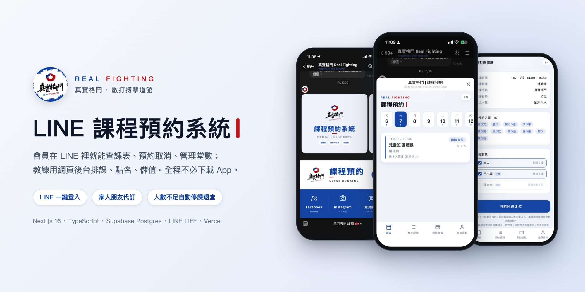
</p>

<h1 align="center">真實格鬥 LINE 課程預約系統</h1>

<p align="center">
  為散打搏擊道館打造的課程預約平台。<br>
  會員在 <b>LINE</b> 裡查課表、預約、管理堂數；教練在<b>網頁後台</b>排課、點名、儲值。
</p>

<p align="center">
  
  
  
  
  
  
  
</p>

<p align="center">
  <a href="#會員端">會員端</a> ·
  <a href="#教練後台">教練後台</a> ·
  <a href="#幕後自動化">幕後自動化</a> ·
  <a href="#技術架構">技術架構</a> ·
  <a href="#工程重點">工程重點</a>
</p>

---

## 產品概念

| 🙌 會員零門檻 | ⏱️ 教練少做事 | 🛡️ 規則由系統把關 |
|:--|:--|:--|
| 在 LINE 官方帳號點選單就能開啟，以 LINE 身分自動登入。不用下載 App，也不用記帳號密碼。 | 開班判斷、停課退堂、LINE 通知都自動完成。教練只需要排課與儲值，取消原先紙本與人工作業。 | 預約截止、取消期限、扣堂與退堂都在資料庫交易中執行，不會超賣，也不會算錯堂數。 |

> 已部署於 Vercel，目前在道館試營運中。<br>
> 截圖中的會員、教練與課程皆為示範資料，姓名與電話均為虛構。

---

## 會員端

會員端是在 LINE 內開啟的手機版網頁（LINE LIFF）。底部有四個分頁：**課表、預約紀錄、剩餘堂數、會員資料**。

<table>
<tr>
<td width="42%" align="center">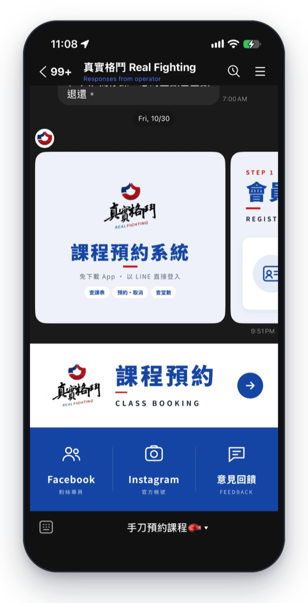</td>
<td>
<h3>① 從 LINE 一鍵進入</h3>
<p>加入道館的 LINE 官方帳號後，點圖文選單「課程預約」，系統會直接在 LINE 內開啟並自動登入。</p>
<ul>
<li>不用下載 App，也不用另外註冊帳號</li>
<li>登入身分由伺服器向 LINE 驗證，無法偽造</li>
<li>預約、取消、儲值、停課等通知都會發到這個聊天室</li>
</ul>
</td>
</tr>
<tr>
<td>
<h3>② 首次註冊，填一次就好</h3>
<p>LINE 帳號只用來登入，道館以會員填寫的真實資料核對身分、聯絡緊急聯絡人。</p>
<ul>
<li>必填欄位漏填時，以紅框標示並提示「此欄位為必填」</li>
<li>真實姓名與電話送出後即鎖定，需要更正時由教練在後台修改</li>
<li>註冊完成前不能預約，避免資料不完整</li>
</ul>
</td>
<td width="42%" align="center">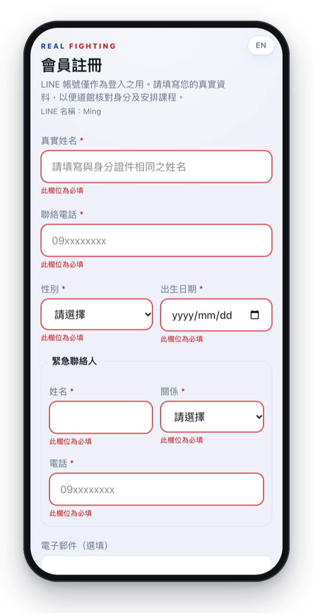</td>
</tr>
<tr>
<td align="center">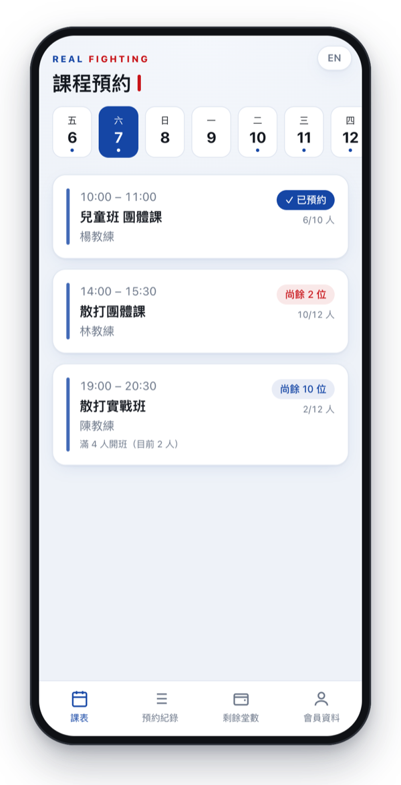</td>
<td>
<h3>③ 課表一目了然</h3>
<p>一次載入未來 21 天的課表，切換日期即時顯示，有課的日子下方會有圓點。</p>
<ul>
<li>狀態標籤：尚餘 n 位（剩 3 位以內轉紅）、已額滿、✓ 已預約、已截止、停課</li>
<li>「滿 4 人開班（目前 2 人）」提示，鼓勵會員揪朋友一起上課</li>
<li>私人課只有名單內的會員看得到</li>
</ul>
</td>
</tr>
<tr>
<td>
<h3>④ 一次幫全家預約</h3>
<p>可以同時勾選自己和家人朋友，每個人扣自己的堂數。</p>
<ul>
<li>不能預約的人會在按下預約前直接顯示原因，例如「團體堂數不足」「已截止預約」</li>
<li>其中一人失敗時，其他人仍照常預約成功</li>
<li>已預約名單會遮罩姓名（王小明 → 王Ｏ明），保護會員隱私</li>
</ul>
</td>
<td align="center">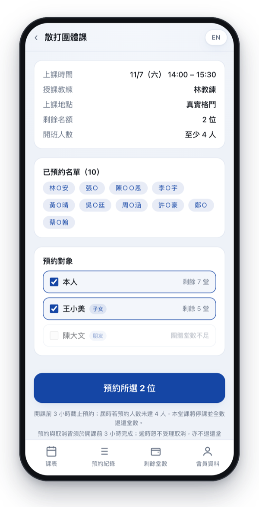</td>
</tr>
<tr>
<td align="center">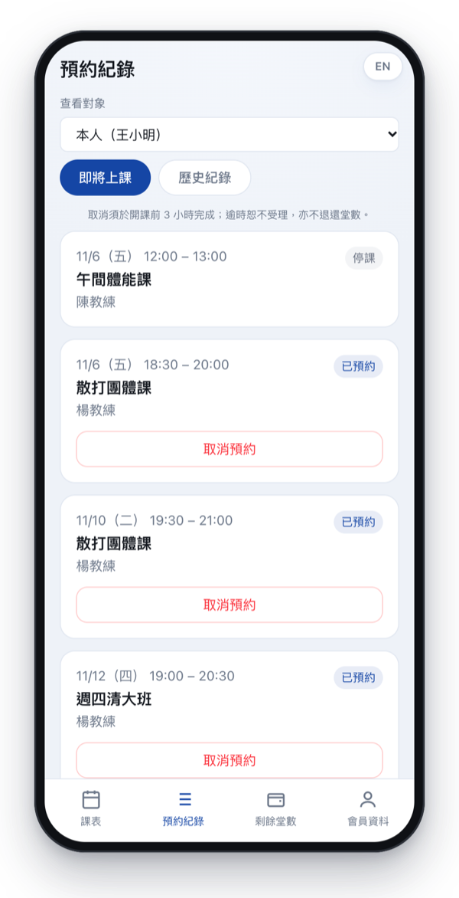</td>
<td>
<h3>⑤ 預約紀錄與取消</h3>
<p>分成「即將上課」和「歷史紀錄」兩頁，有成員時可以切換要查看的人。</p>
<ul>
<li>開課前 3 小時之前可以自行取消，堂數自動退還</li>
<li>超過取消期限後，取消按鈕自動消失</li>
<li>清楚標示已預約、已出席、未出席、停課</li>
</ul>
</td>
</tr>
<tr>
<td>
<h3>⑥ 剩餘堂數</h3>
<p>團體課與私人課的堂數分開計算，每筆都有有效期限。</p>
<ul>
<li>預約時優先扣除最快到期的那一筆</li>
<li>過期或用完的堂數歸到「已失效」頁，仍可查詢</li>
<li>教練儲值後，這一頁立即更新，同時收到 LINE 通知</li>
</ul>
</td>
<td align="center">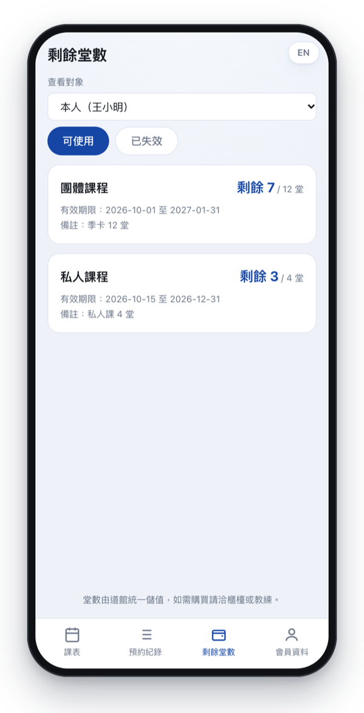</td>
</tr>
<tr>
<td align="center">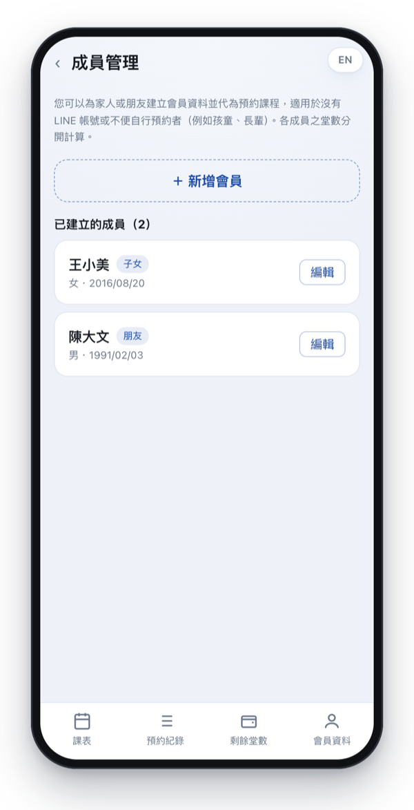</td>
<td>
<h3>⑦ 家人、朋友代訂</h3>
<p>替孩童、長輩或沒有 LINE 的朋友建立會員資料，由帳號持有人代為預約。</p>
<ul>
<li>關係可選子女、配偶、父母、兄弟姊妹、朋友等</li>
<li>每位成員有自己的堂數與預約紀錄</li>
<li>成員的通知一律發給帳號持有人，並註明是哪一位成員</li>
</ul>
</td>
</tr>
<tr>
<td>
<h3>⑧ 中英雙語</h3>
<p>道館有外籍會員與家長，介面和 LINE 通知都提供英文。</p>
<ul>
<li>右上角一鍵切換「中／EN」</li>
<li>新會員第一次進入時，依 LINE App 的語言自動選擇</li>
<li>介面、錯誤訊息、LINE 推播共用同一份字典，用語一致</li>
</ul>
</td>
<td align="center">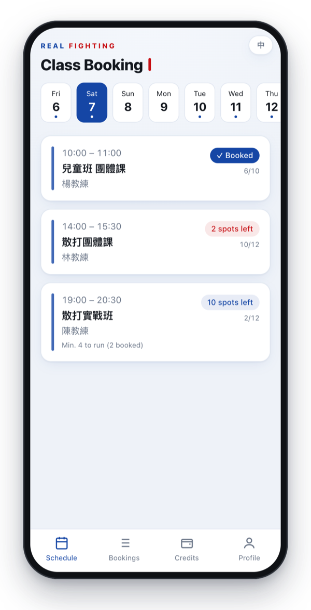</td>
</tr>
</table>

---

## 教練後台

教練用瀏覽器登入 `/admin`，在電腦或手機上都能使用。後台分為三個區塊：**課程、會員／堂數、教練**。

<table>
<tr>
<td width="50%" valign="top">
<h3>近期課程</h3>
<p>依日期分組，每堂課直接標示開班狀態：還差 n 人開班、已達開班人數、確定開班、人數不足即將停課。</p>
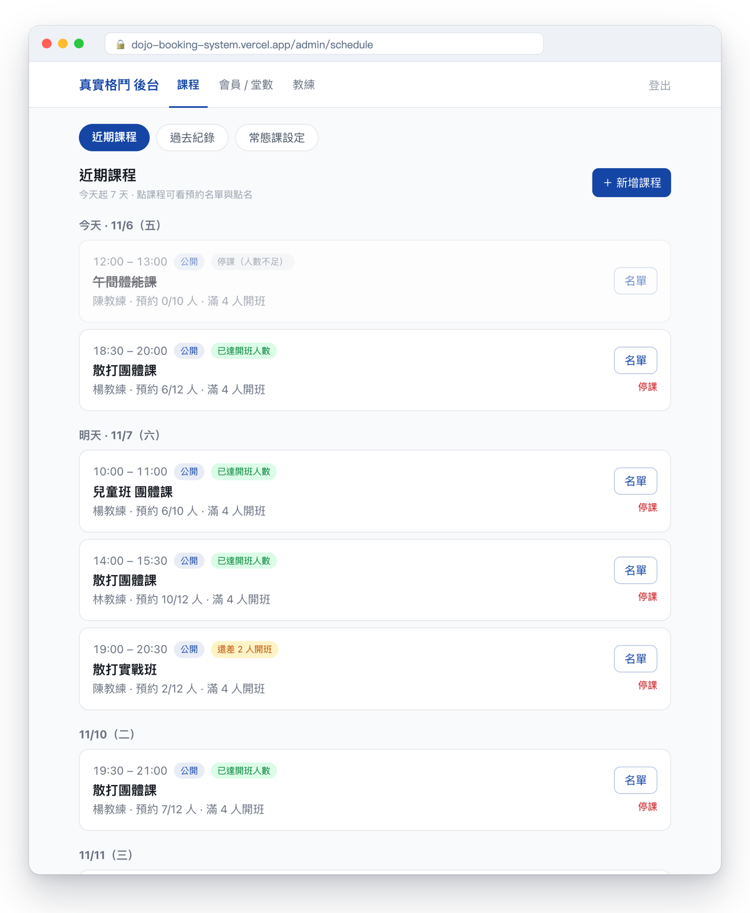
</td>
<td width="50%" valign="top">
<h3>名單與點名</h3>
<p>每位學員都可以按報到、未到或強制取消（自動退堂）。代訂成員會註明「由 ○○ 代訂」，並顯示 LINE 暱稱，方便和聊天室對照。</p>
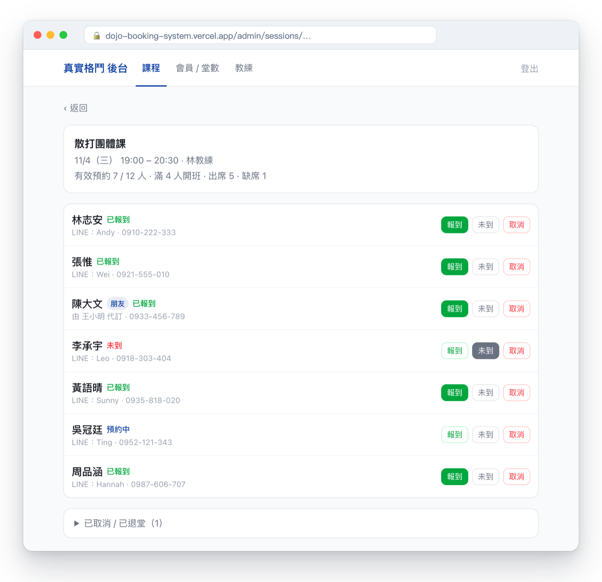
</td>
</tr>
<tr>
<td valign="top">
<h3>堂數管理</h3>
<p>手動加堂數後，系統自動發 LINE 通知給會員。已建立的堂數可以修改或刪除，並有防呆規則：</p>
<ul>
<li>修改總堂數時，已使用的堂數維持不變</li>
<li>剩餘加上尚未上課的預約，不可超過總堂數</li>
<li>已被預約使用過的堂數不能刪除，只能把剩餘歸零或縮短期限</li>
</ul>
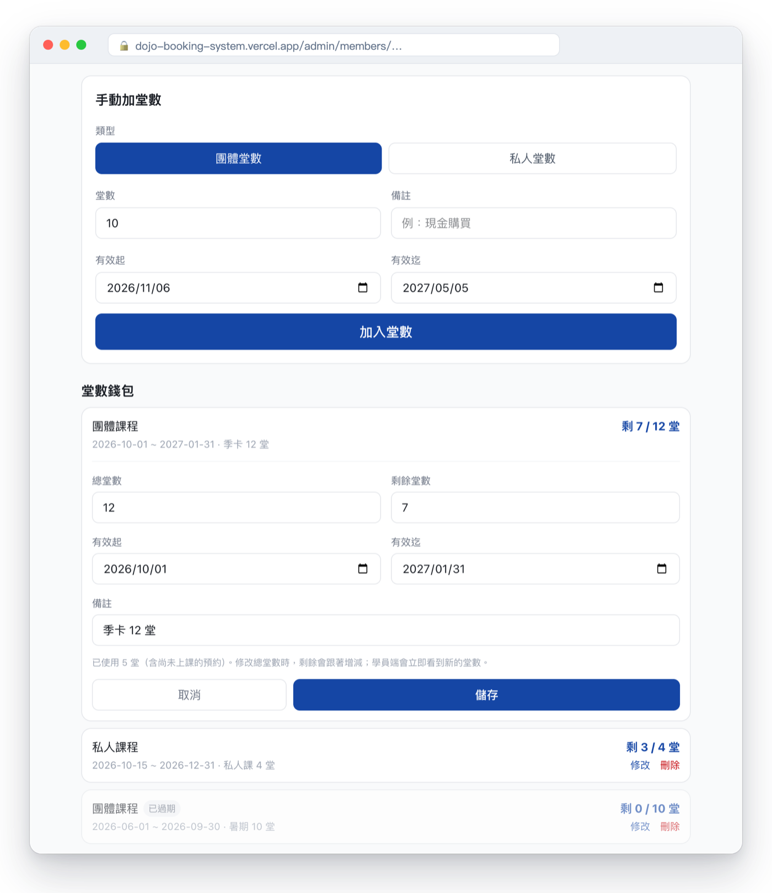
</td>
<td valign="top">
<h3>新增與設定課程</h3>
<p>一張表單就能建立不同類型的課程，修改常態課後，設定會套用到未來所有場次。</p>
<ul>
<li>公開課（所有人可見）或私人課（只開放給名單內的會員）</li>
<li>每週重複或單堂課程</li>
<li>人數上限與開班人數都能逐課調整</li>
</ul>
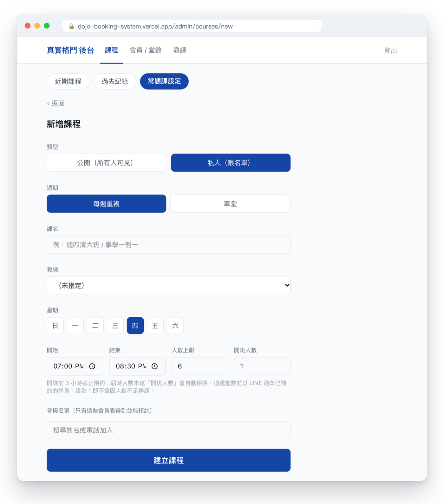
</td>
</tr>
<tr>
<td valign="top">
<h3>過去紀錄</h3>
<p>已開班的課程依月份整理，顯示參加、出席、缺席人數，點進去可以看當堂名單。</p>
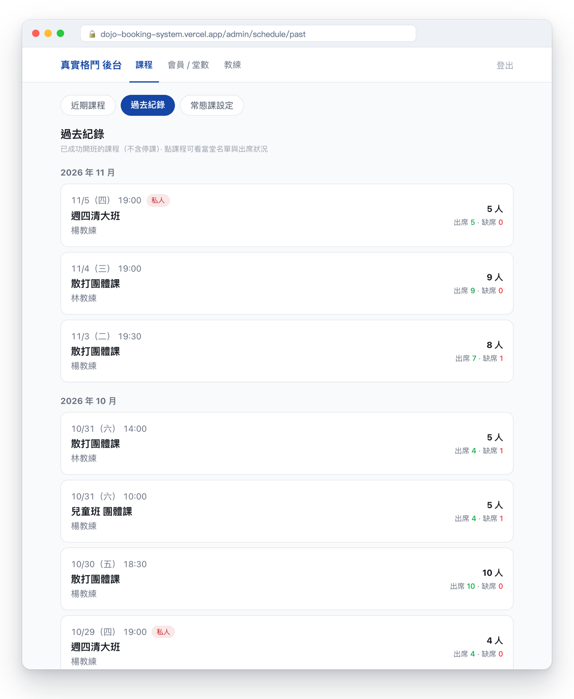
</td>
<td valign="top">
<h3>會員搜尋</h3>
<p>可以用真實姓名、LINE 暱稱或電話搜尋。教練在聊天室看到暱稱「Apple」，搜尋 Apple 就能找到本名。列表也會標示未註冊與代訂成員。</p>
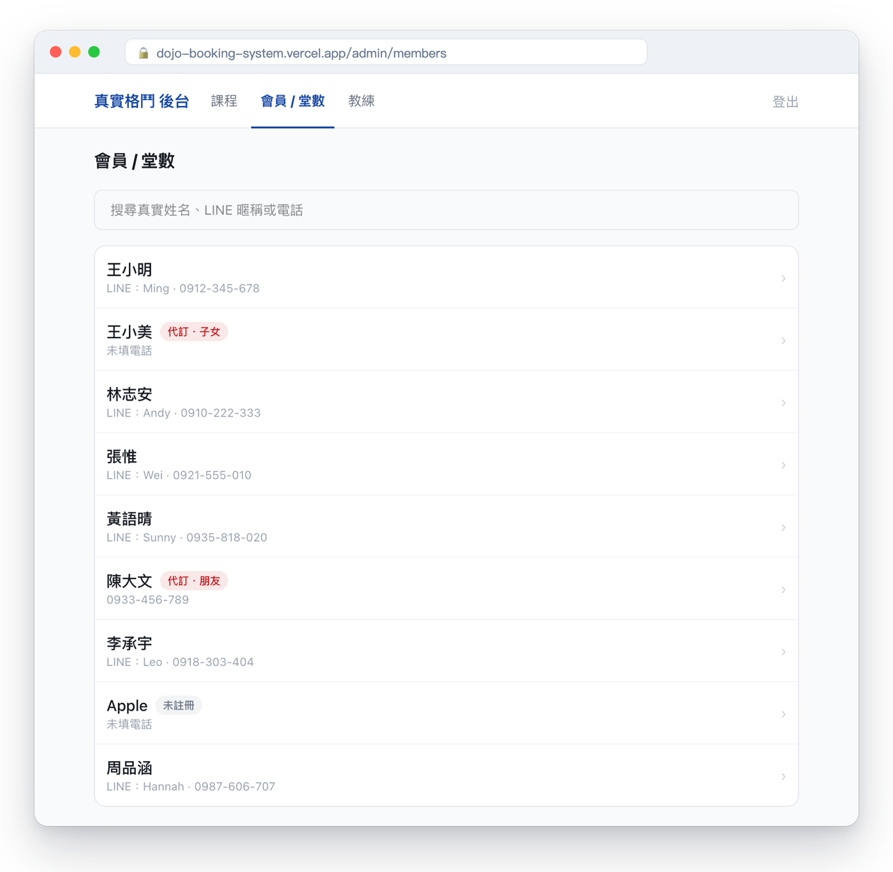
</td>
</tr>
</table>

---

## 幕後自動化

教練不必盯著時間，以下工作由系統自動完成：

| 時機 | 系統動作 |
|---|---|
| **開課前 3 小時** | 截止預約與取消。人數達到開班人數就確定開班；未達到則**自動停課、全數退還堂數，並以 LINE 通知已預約的會員** |
| **每晚 20:00** | 推播隔天的上課提醒 |
| **預約、取消、儲值時** | 即時推播確認訊息；代訂成員的通知發給帳號持有人 |

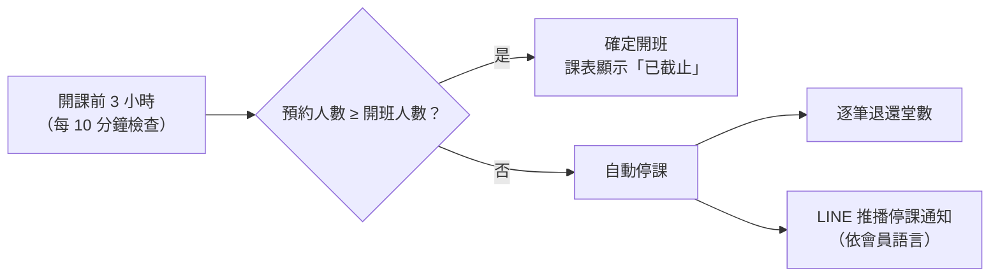

LINE 通知共五種：✅ 預約成功、取消預約通知、💳 堂數儲值通知、⏰ 明日課程提醒、⚠️ 停課通知。

---

## 技術架構

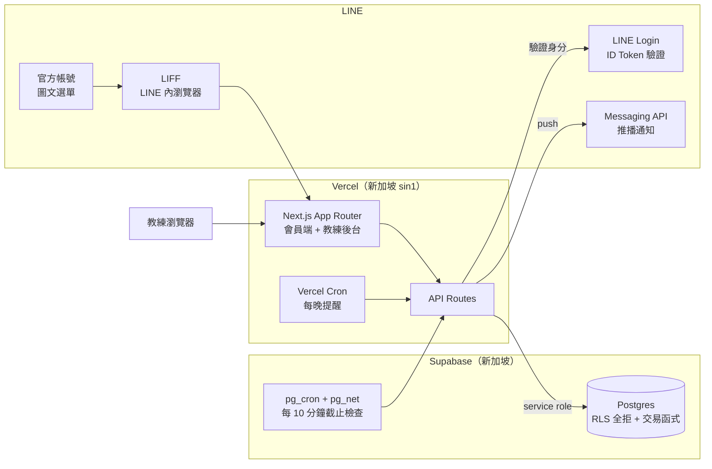

| 層 | 技術 |
|---|---|
| 前端／後端 | Next.js 16（App Router、Turbopack）、React 19、TypeScript |
| 樣式 | Tailwind CSS v4，自訂品牌設計 token |
| 資料庫 | Supabase Postgres；預約、取消、停課等核心邏輯寫成 PL/pgSQL 函式 |
| 身分驗證 | LINE LIFF＋LINE Login ID Token 伺服器端驗證；HMAC 簽章 httpOnly cookie |
| 通知 | LINE Messaging API push |
| 排程 | Supabase pg_cron（每 10 分鐘截止檢查）、Vercel Cron（每晚提醒） |
| 部署 | GitHub → Vercel 自動部署；函式與資料庫同在新加坡區域 |

更完整的資料表欄位、API 一覽與商業規則，請見 [技術文件](docs/ARCHITECTURE.md)。

<details>
<summary><b>資料模型</b></summary>

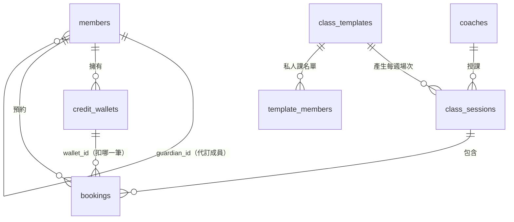

- `members`：一般會員與代訂成員共用一張表，以 `guardian_id` 自我關聯
- `credit_wallets`：每次儲值一筆，含類型、總堂數、剩餘、有效期限
- `class_templates` → `class_sessions`：常態課範本產生實際場次，場次可個別停課或調整
- `bookings`：記錄扣了哪一筆堂數，取消時退回同一筆

</details>

<details>
<summary><b>專案結構</b></summary>

```
src/
  app/
    (member)/          會員端（課表、課程詳情、預約紀錄、堂數、會員資料、成員管理、註冊）
    admin/             教練後台（登入、近期課程、過去紀錄、常態課、名單、會員、教練）
    api/               API Routes（會員、課程、預約、堂數、後台、排程）
  components/          LIFF 初始化、底部導覽、共用表單元件、後台導覽
  lib/                 身分驗證、資料存取、課程狀態判斷、i18n 字典、LINE 推播、日期工具
db/                    依序執行的 SQL migration（資料表、交易函式、RLS、排程）
```

</details>

---

## 工程重點

**資料一致性：不會超賣、不會算錯堂數**
預約扣堂、取消退堂、截止停課都寫成 Postgres 函式，在單一交易內完成，並以 `SELECT … FOR UPDATE` 鎖定場次與堂數。即使多人同時搶最後一個名額，也只有一人會成功。

**安全設計**
- 會員身分以 LINE ID Token 在伺服器端驗證，之後改用 HMAC 簽章的 httpOnly cookie；API 不信任前端傳來的使用者 ID
- 資料庫所有資料表開啟 RLS 且不設任何 policy，前端無法直接存取，只有伺服器端能使用 service role
- 代訂授權只允許操作「本人」或「自己建立的成員」
- 排程端點需要 Bearer secret，未設定時一律拒絕（fail-closed）

**效能優化**
- 將 Vercel Functions 移到與資料庫相同的新加坡區域，API 回應時間從約 1.5–2.1 秒降到約 0.28 秒
- 開啟 App 時，課表與 LINE 登入流程並行載入；回訪會員跳過重複的 LINE 驗證
- 獨立的資料庫查詢改成並行執行，減少等待時間

**前後端共用的商業規則**
課程狀態（可預約、已截止、停課）由同一個模組判斷，前端每分鐘自動更新畫面，時間一到狀態就會切換，不用重新整理。全系統的日期與截止時間都以台北時區計算。

**為真實營運設計**
處理了實際上課會遇到的情境：幫家人代訂、部分成員預約失敗、私人課名單、開班人數門檻、堂數有效期限、外籍會員的英文介面，以及教練需要修正堂數時的防呆規則。

---

## 本機開發

```bash
npm install
cp .env.local.example .env.local   # 填入 Supabase 與 LINE 的設定
npm run dev                        # http://localhost:3000
```

- 在 `localhost` 開啟時會自動使用開發用的假身分，不必進 LINE 也能開發會員端
- 教練後台位於 `/admin`
- 資料庫請依序在 Supabase SQL Editor 執行 `db/01` 至 `db/08`
- 資料庫、API、部署與 LINE 設定的完整說明，請見 [技術文件](docs/ARCHITECTURE.md)

---

## 開發歷程

| 階段 | 內容 |
|---|---|
| M0–M4 | 環境建置、LIFF 登入、資料庫、會員核心功能（課表、預約扣堂、取消退堂、堂數）、教練後台 |
| 身分強化 | ID Token 伺服器端驗證、簽章 cookie |
| M5–M6 | LINE 推播通知、部署到 Vercel、真人手機測試 |
| M7 | 公開／私人課程、私人課名單 |
| M8 | 會員註冊與資料鎖定、家人朋友代訂（多人一次預約）、中英雙語 |
| M9 | 預約截止與開班人數、自動停課退堂通知、表單驗證、後台導覽與過去紀錄 |
| 效能與維運 | 函式區域搬遷、預先載入課表、查詢並行化、後台修改／刪除堂數 |

**下一步**：候補名單、堂數即將到期提醒、教練個別帳號與操作紀錄、場次自動延展。

---

<p align="center">
  <sub>真實格鬥 Real Fighting · 散打搏擊道館課程預約系統</sub>
</p>
