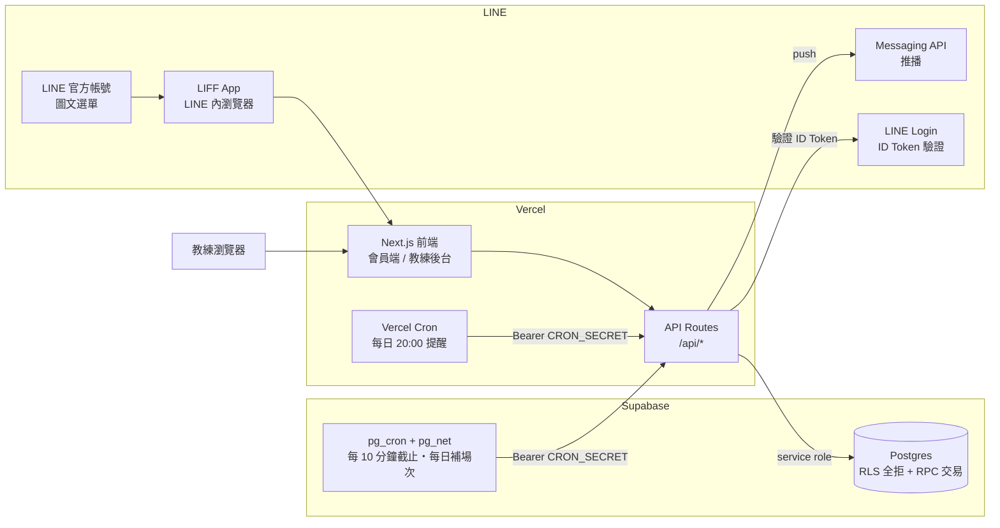
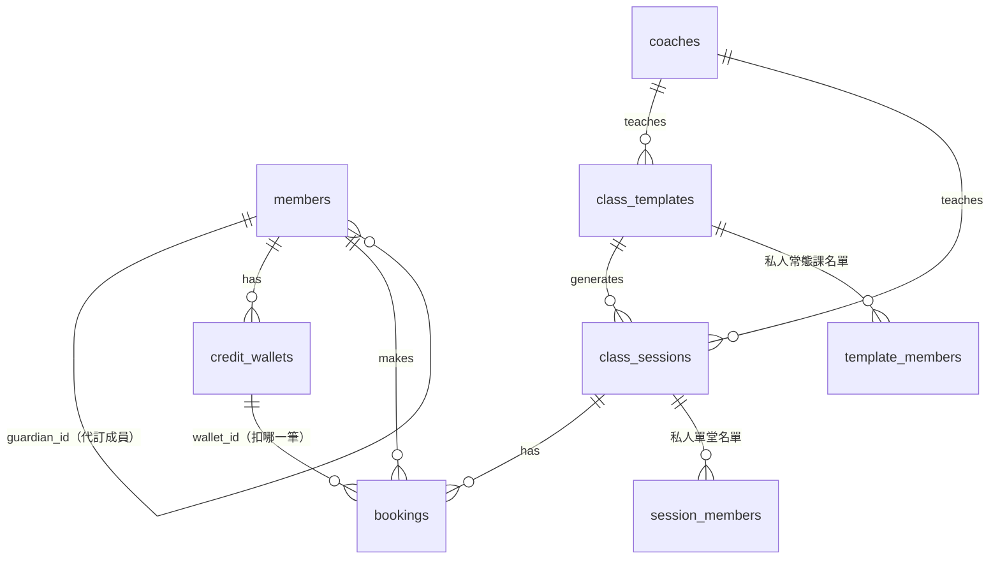
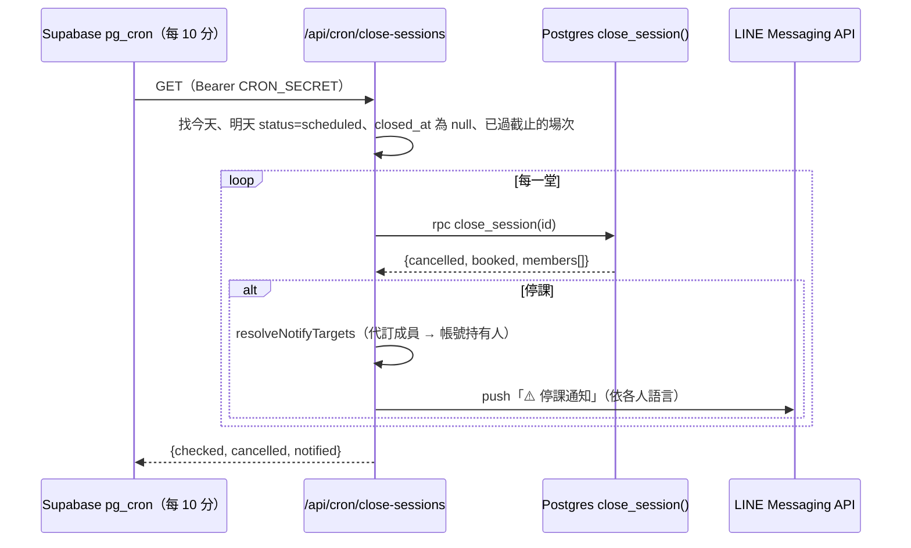

# 真實格鬥 LINE 課程預約系統 — 技術文件

> 產品功能介紹請見 [README](../README.md)。本文件說明架構、資料庫、API、本機開發與部署。
> 本文件**不含任何密鑰**，環境變數只列名稱。

---

## 1. 系統總覽



| 層 | 技術 |
|---|---|
| 前端／後端 | **Next.js 16.2.11**（App Router、Turbopack）、React 19.2、TypeScript |
| 樣式 | Tailwind CSS v4（設計 token 在 `src/app/globals.css`） |
| 資料庫 | Supabase Postgres（只在伺服器端用 service role 存取；RLS 預設全部拒絕） |
| 身分 | LINE LIFF 2.29（`@line/liff`）＋ LINE Login ID Token 伺服器端驗證 |
| 通知 | LINE Messaging API push |
| 排程 | Vercel Cron（每日一次，Hobby 方案限制）＋ Supabase pg_cron（每 10 分鐘截止檢查、每天補足場次） |
| 部署 | GitHub `AFKsteamED/dojo-booking-system`，push 到 `main` 後 Vercel 自動部署 |
| 地區 | Vercel 函式 **sin1（新加坡）**，與 Supabase **ap-southeast-1（新加坡）** 同區（`vercel.json` 的 `regions`）。不要改回其他地區，否則每次查詢資料庫都要跨洋，API 會慢上數倍 |

> ⚠️ Next.js 16 的 API 與慣例和舊版不同。修改前請先讀 `node_modules/next/dist/docs/` 中對應的指南（專案的 `AGENTS.md` 也有要求）。

---

## 2. 目錄結構

```
db/                         SQL migration，依序在 Supabase SQL Editor 執行（見 §9）
docs/                       本文件與 README 截圖
src/
  app/
    layout.tsx              根 layout（title「真實格鬥 | 課程預約」）
    icon.png                網站圖示（道館標誌）
    globals.css             設計 token、日期欄位修正、全站互動樣式
    (member)/               會員端（LIFF 內開啟，手機版）
      layout.tsx            LiffProvider → LanguageToggle → RegistrationGate → BottomNav
      page.tsx              課表（一次載入 21 天、前端依日期篩選）
      session/[id]/         課程詳情＋預約（可多人勾選）
      bookings/             預約紀錄＋取消
      credits/              剩餘堂數
      profile/              會員資料
      family/               成員管理（代訂家人/朋友）
      register/             首次註冊
    admin/
      login/                後台登入
      (protected)/          需登入（layout 檢查 isAdmin）
        schedule/           近期課程（依日分組、開班狀態）
        schedule/past/      過去紀錄（已開班課程）
        courses/            常態課設定；new/ 新增課程；[id]/ 編輯＋私人名單
        sessions/[id]/      單堂名單、點名、停課原因
        members/            會員搜尋；[id]/ 會員詳細、加堂數
        coaches/            教練管理
    api/                    見 §6
  components/
    liff-provider.tsx       LIFF 初始化、會員同步、household、locale、t()
    registration-gate.tsx   未完成註冊 → 導向 /register
    bottom-nav.tsx          會員端底部 4 分頁
    language-toggle.tsx     右上角 中/EN
    form.tsx                共用表單：Field / TextInput / SelectInput / 各種關係選單（必填紅框）
    admin-nav.tsx           後台導覽（目前頁面標示）＋課程子分頁
    wordmark.tsx            REAL FIGHTING 字標
  lib/
    supabase.ts             service role client（server-only）
    server-db.ts            會員查詢、getActingMember、createDependent、syncMember、isProfileComplete、私人課資格
    member-session.ts       會員 session cookie（HMAC 簽章）
    line-verify.ts          向 LINE 驗證 ID Token
    admin-auth.ts           後台共用密碼＋簽章 cookie、guardAdmin()
    session-status.ts       課程狀態判斷（open/closed/cancelled），前後端共用
    i18n.ts                 中英字典（介面＋錯誤＋推播）、localeFromLanguage()
    line-push.ts            pushText（失敗不拋錯）
    notify.ts               推播訊息的課程資訊區塊
    notify-targets.ts       通知對象解析（代訂成員 → 帳號持有人）
    booking-errors.ts       DB 錯誤碼 → 多語訊息
    profile.ts              性別、關係選項與驗證
    mask.ts                 名單姓名遮罩
    date-utils.ts           台北時區日期工具（todayInTaipei、addDaysStr、星期）
    use-now.ts              每分鐘更新的現在時間（讓狀態自動切換）
    client-api.ts / admin-api.ts   前端呼叫 API 的封裝
    types.ts                共用型別
```

---

## 3. 身分與安全

### 3.1 會員身分
1. 會員在 LINE 內開啟 LIFF → `initLiff()` 取得 **ID Token**、LINE App 語言；名字與頭像從 `getDecodedIDToken()` 在本機解碼（不另外呼叫 `getProfile()`）。同一時間，若要進課表頁，`schedule-prefetch.ts` 會先開始抓課表。
2. 前端呼叫 `POST /api/members/sync`，送出 `{ idToken, lang }`。
3. 伺服器向 LINE 驗證 ID Token（`LINE_LOGIN_CHANNEL_ID`）→ 建立或更新會員（新會員依語言預設 `locale`，並同步 LINE 暱稱到 `line_display_name`）→ 設定 **httpOnly 簽章 cookie `member_session`**（有效 30 天）。
4. **回訪快速路徑**：如果已經有有效的 cookie，且 ID Token 的 `sub` 與 cookie 是同一人，就跳過向 LINE 驗證（cookie 本身就是先前驗證過的證明）。這條路徑不更新暱稱、不延長 cookie，所以最長 30 天會走一次完整驗證。sync 會一併回傳代管成員。
5. 之後所有會員 API **只從 cookie 取得身分**，不信任前端傳來的 userId。
6. **代訂授權**：`getActingMember(session, memberId)` 只允許操作「本人」或「`guardian_id` = 本人」的成員；其他一律回 `NOT_YOUR_FAMILY`。
7. **開發模式**：在 localhost 或沒有設定 LIFF ID 時，使用假身分 `U_dev_mock_0001`（mock sync，不經 LINE 驗證）。

### 3.2 後台身分
- 一組共用密碼 `ADMIN_PASSWORD`，登入後設定簽章 cookie `admin_session`（HMAC，使用 `ADMIN_SESSION_SECRET`）。
- 每個 admin API 開頭都呼叫 `guardAdmin()`；`(protected)/layout.tsx` 未登入時導向 `/admin/login`。

### 3.3 資料庫
- 所有資料表都**開啟 RLS 而且沒有任何 policy**，前端無法直接存取資料庫。
- 只有伺服器端（`src/lib/supabase.ts`，`import "server-only"`）使用 service role key。
- 需要原子性的操作（預約扣堂、取消退堂、截止停課）都放在 Postgres 函式裡，以單一交易完成，並用 `for update` 鎖定資料列，避免超賣。

### 3.4 排程端點
- `/api/cron/*` 需要 `Authorization: Bearer <CRON_SECRET>`。未設定密鑰時回 503，也就是預設拒絕（fail-closed）。
- `close-sessions` **只接受 header**。`reminders` 目前另外接受 `?secret=` 方便本機測試（見 §11 技術債）。

### 3.5 隱私
- 會員端名單用 `maskName()` 遮罩；完整資料只在後台顯示。

---

## 4. 資料模型



| 資料表 | 重要欄位 |
|---|---|
| `members` | `line_user_id`（代訂成員為 null）、`display_name`（真實姓名，註冊後鎖定）、`line_display_name`、`phone`、`email`、`gender`(male/female/undisclosed)、`birthday`、`emergency_contact_name/phone/relation`(father/mother/spouse/child/sibling/friend/other)、`registered_at`、`locale`(zh/en)、`guardian_id`、`relation`(child/spouse/parent/sibling/friend/other) |
| `coaches` | `name`、`active` |
| `class_templates` | 每週固定課：`title`、`coach_id`、`weekday`(0=日)、`start_time`、`end_time`、`capacity`、`min_attendance`、`visibility`(public/private)、`active` |
| `class_sessions` | 實際場次：同上欄位＋`session_date`、`status`(scheduled/cancelled)、`cancel_reason`(manual/insufficient)、`closed_at`（截止處理完成時間）；`(template_id, session_date)` 唯一 |
| `credit_wallets` | 堂數錢包：`type`(group/private)、`total_credits`、`remaining_credits`、`valid_from`、`valid_to`、`note` |
| `bookings` | `member_id`、`session_id`、`wallet_id`、`status`(booked/cancelled/attended/no_show)、`credits_used`、`cancelled_at`；同一會員同一場最多一筆 `booked` |
| `template_members` / `session_members` | 私人課名單 |
| `admins` | 早期預留，目前未使用（後台改用共用密碼） |

**有效預約** = `status in (booked, attended, no_show)`，人數統計與名單都用這個定義。

**資料完整（`isProfileComplete`）**：
- 帳號持有人：姓名、性別、生日、`registered_at`、電話、緊急聯絡人姓名與電話。
- 代訂成員：姓名、性別、生日。

---

## 5. 核心商業邏輯（Postgres 函式）

| 函式 | 行為 |
|---|---|
| `generate_sessions(p_weeks=8)` | 為每個 active 範本產生「台北今天起 N 週」的場次（已存在則略過，包含已停課的），並帶入人數上限、可見性、開班人數。**每天台北 03:00 由 pg_cron 執行**，後台新增或修改常態課時也會立即執行 |
| `book_session(member, session)` | 依序檢查：場次存在 → 未停課 → **未過截止（開課前 3h，台北時間）** → 私人課資格 → 未額滿 → 有可用錢包（類型相符、日期在有效期內、優先扣最早到期）→ 寫入預約並扣 1 堂。錯誤碼：`SESSION_NOT_FOUND / SESSION_CANCELLED / BOOKING_CLOSED / NOT_ELIGIBLE / FULL / NO_CREDITS / ALREADY_BOOKED` |
| `cancel_booking(member, booking, cutoff=3)` | 會員取消：必須是本人的 `booked` 預約，且在開課前 3h 之前 → 改為 cancelled 並退 1 堂。錯誤碼：`BOOKING_NOT_FOUND / NOT_YOURS / NOT_ACTIVE / TOO_LATE` |
| `close_session(session)` | 截止處理（可重複呼叫）：已處理或未到截止 → 略過；已開課或人數 ≥ 開班人數 → 只寫入 `closed_at`；人數不足 → 取消所有有效預約、逐筆退堂、場次改為 cancelled（reason `insufficient`），回傳被退堂的會員 id |

### 5.1 課程狀態（`src/lib/session-status.ts`，前後端共用）

```
status = cancelled                                  → cancelled（停課）
now < 開課前 3h                                       → open（可預約）
now ≥ 截止 且 人數 < min_attendance 且 now < 開課     → cancelled（畫面先顯示停課，等排程正式處理）
其他                                                 → closed（已截止，照常上課）
```

### 5.2 自動停課流程



---

## 6. API 一覽

### 會員端（身分取自 `member_session` cookie）
| Method & Path | 用途 |
|---|---|
| `POST /api/members/sync` | 驗證 ID Token（回訪且 cookie 相符時跳過）、建立或同步會員、設定 cookie；回傳 `{member, profileComplete, dependents}` |
| `POST /api/members/register` | 首次註冊（必填欄位驗證，寫入 `registered_at`） |
| `PATCH /api/members/me` | 修改性別、生日、緊急聯絡人、Email（姓名與電話不可改） |
| `POST /api/members/locale` | 切換語言 |
| `GET /api/members/household` | 本人＋代訂成員 |
| `POST /api/members/dependents` / `PATCH .../[id]` | 新增或修改代訂成員（姓名建立後不可改） |
| `GET /api/sessions?from&to` | 日期區間內看得到的場次（含停課）＋人數＋`household_booked`，以及 `viewer`（以哪位會員身分查的，用來判斷預先載入的結果能不能直接用） |
| `GET /api/sessions/[id]` | 場次詳情、遮罩名單、每位家庭成員的狀態（是否已預約、資格、堂數） |
| `GET /api/bookings?scope=upcoming\|past&memberId` | 預約紀錄（含 `sessionCancelled`） |
| `POST /api/bookings` `{sessionId, memberIds[]}` | 多人預約；逐人呼叫 `book_session`，回傳各人結果，並發一則彙整推播 |
| `POST /api/bookings/[id]/cancel` | 取消（本人或自己的代訂成員），推播取消通知 |
| `GET /api/credits?memberId` | 堂數錢包（可用／已失效） |

### 後台（`guardAdmin()`）
| Method & Path | 用途 |
|---|---|
| `POST /api/admin/login` / `logout` | 登入、登出 |
| `GET /api/admin/sessions/upcoming?days=7` | 今天起 N 天的場次（含有效人數） |
| `GET /api/admin/sessions/past?offset&limit` | 已開班的過去場次＋出席統計 |
| `GET /api/admin/sessions/[id]` | 名單（含關係、代訂人、LINE 暱稱） |
| `POST /api/admin/sessions/[id]/cancel` | 手動停課＋全數退堂（reason `manual`，**不推播**） |
| `PATCH /api/admin/bookings/[id]` `{action}` | 報到 / 未到 / 強制取消（退堂，**不推播**） |
| `POST /api/admin/courses` | 新增課程（公開/私人 × 每週/單堂，含 `min_attendance`） |
| `GET/PATCH/POST/DELETE /api/admin/templates[/id]` | 常態課列表、編輯（套用到未來未處理場次）、停用、私人名單增刪 |
| `GET /api/admin/members?q` / `GET,PATCH .../[id]` | 會員搜尋、詳細、修改（含鎖定欄位、關係、語言） |
| `POST /api/admin/members/[id]/credits` | 加堂數＋推播 |
| `PATCH/DELETE /api/admin/wallets/[id]` | 修改堂數（剩餘＋未上課預約 ≤ 總堂數）；刪除僅限從未被預約使用過的 |
| `GET/POST /api/admin/coaches`、`PATCH .../[id]` | 教練管理 |

### 排程
| Path | 觸發 | 用途 |
|---|---|---|
| `GET /api/cron/reminders` | Vercel Cron `0 12 * * *`（UTC，等於台北 20:00） | 推播隔天課程提醒 |
| `GET /api/cron/close-sessions` | Supabase pg_cron `*/10 * * * *`（`db/08`） | 截止處理、自動停課與通知 |
| （無 API，直接在資料庫執行） | Supabase pg_cron `0 19 * * *`（UTC，等於台北 03:00；`db/09`） | `generate_sessions(8)` 補足未來 8 週場次 |

---

## 7. 多語系（i18n）

- 字典在 `src/lib/i18n.ts`（`zh` / `en`），前端介面、API 錯誤訊息、LINE 推播共用。
- 會員的 `locale` 決定介面與推播語言。新會員依 LINE App 語言預設（`zh*` 用中文，其他用英文）；右上角可以切換；後台也可以替會員設定。
- 必填欄位的「*」由 `form.tsx` 自動加上，字典字串本身不含星號。
- 後台介面只有中文。

---

## 8. 環境變數（只列名稱）

| 名稱 | 用途 | 設定位置 |
|---|---|---|
| `NEXT_PUBLIC_LIFF_ID` | LIFF App ID | Vercel、`.env.local` |
| `LINE_LOGIN_CHANNEL_ID` | 驗證 ID Token | Vercel |
| `LINE_CHANNEL_ACCESS_TOKEN` | Messaging API 推播 | Vercel |
| `NEXT_PUBLIC_SUPABASE_URL` / `NEXT_PUBLIC_SUPABASE_ANON_KEY` / `SUPABASE_SERVICE_ROLE_KEY` | 資料庫 | Vercel、`.env.local` |
| `ADMIN_PASSWORD` / `ADMIN_SESSION_SECRET` | 後台登入 | Vercel、`.env.local` |
| `CRON_SECRET` | 排程端點驗證（Supabase `db/08` 也使用相同的值） | Vercel |
| `NEXT_PUBLIC_LIFF_MOCK` | 開發時強制使用假身分（正式環境**不要設**） | 只在本機 |

`.env.local` 已在 `.gitignore` 中。密鑰不可寫進 repo；`db/08` 在 repo 中使用 `<CRON_SECRET>` 佔位符。

---

## 9. 資料庫 Migration

在 Supabase 的 **SQL Editor** 依序貼上並執行（皆已在正式環境執行）：

| 檔案 | 內容 |
|---|---|
| `01_schema.sql` | 基本資料表 |
| `02_functions.sql` | `generate_sessions` / `book_session` / `cancel_booking` |
| `03_rls.sql` | 所有資料表開啟 RLS（不設 policy，全部拒絕） |
| `04_seed.sql` | 初始教練、課程、開發測試會員 |
| `05_private_classes.sql` | `visibility`、私人課名單、`book_session` 加入資格檢查 |
| `06_family_i18n.sql` | `locale`、`guardian_id`、註冊欄位、`line_display_name` |
| `07_attendance_relations.sql` | 關係欄位、`min_attendance`、`cancel_reason`、`closed_at`、`BOOKING_CLOSED`、`close_session()` |
| `08_cron_close_sessions.sql` | 開啟 pg_cron／pg_net，每 10 分鐘呼叫 close-sessions |
| `09_cron_extend_sessions.sql` | `generate_sessions` 改以台北日期為起點；pg_cron 每天台北 03:00 補足未來 8 週場次 |

- `04_seed.sql` 含開發用的測試會員 `U_dev_mock_0001`；新建正式環境時，教練與課程請改成實際資料。
- `08_cron_close_sessions.sql` 中的 `<CRON_SECRET>` 執行前要換成與 Vercel 相同的值（repo 內只保留佔位符）。

**部署順序原則**：新程式如果會讀取新欄位，必須**先在 Supabase 執行 SQL，再 push 程式**，否則正式站會出錯。

常用維護指令（SQL Editor）：

```sql
-- 往後補產生場次（例：未來 12 週；已存在的場次會略過）
select generate_sessions(12);
```

---

## 10. 開發與部署流程

### 本機開發
- `cp .env.local.example .env.local` 並填入設定，執行 `npm run dev`，開 http://localhost:3000 會自動使用假身分；後台是 `/admin`。
- 本機連的是**正式的 Supabase**，測試請用明確標記的測試資料，測完清除。
- 檢查：`npx tsc --noEmit`、`npx eslint src`、`npm run build`。

### 部署到 Vercel
1. 在 Vercel import 此 GitHub repo，Framework 自動偵測為 Next.js。
2. 在 **Settings → Environment Variables** 設定 §8 的變數（不要設 `NEXT_PUBLIC_LIFF_MOCK`；`ADMIN_PASSWORD` 使用正式密碼）。
3. 之後 commit → `git push origin main` 就會自動建置（約 30 秒～2 分鐘）。函式區域由 `vercel.json` 固定在 sin1。

### 接上 LINE
- LINE Developers → LINE Login channel → **LIFF** → Endpoint URL 設為 Vercel 網址。
- LINE Official Account Manager → 圖文選單的按鈕連到 `https://liff.line.me/<LIFF_ID>/<path>`，例如：
  - 課程預約 → `https://liff.line.me/<LIFF_ID>/`
  - 預約紀錄 → `https://liff.line.me/<LIFF_ID>/bookings`
  - 剩餘堂數 → `https://liff.line.me/<LIFF_ID>/credits`
- 推播使用同一個 Provider 下的 Messaging API channel，access token 設為 `LINE_CHANNEL_ACCESS_TOKEN`。

---

## 11. 已知技術債與待辦

| 優先 | 項目 |
|---|---|
| 中 | 後台手動停課、強制取消預約沒有發 LINE 通知 |
| 中 | `reminders` 端點仍接受 `?secret=` 網址參數，應改成和 close-sessions 一樣只收 header |
| 中 | 後台共用一組密碼，沒有個別帳號，也沒有操作紀錄 |
| 低 | `credits` 頁與後台會員選擇器有既有的 `react-hooks/set-state-in-effect` lint 錯誤（不影響建置） |
| 低 | `admins` 資料表未使用 |
| 功能 | 候補名單、堂數到期提醒、點名簡化、後台總覽頁、線上付款（另評估） |
